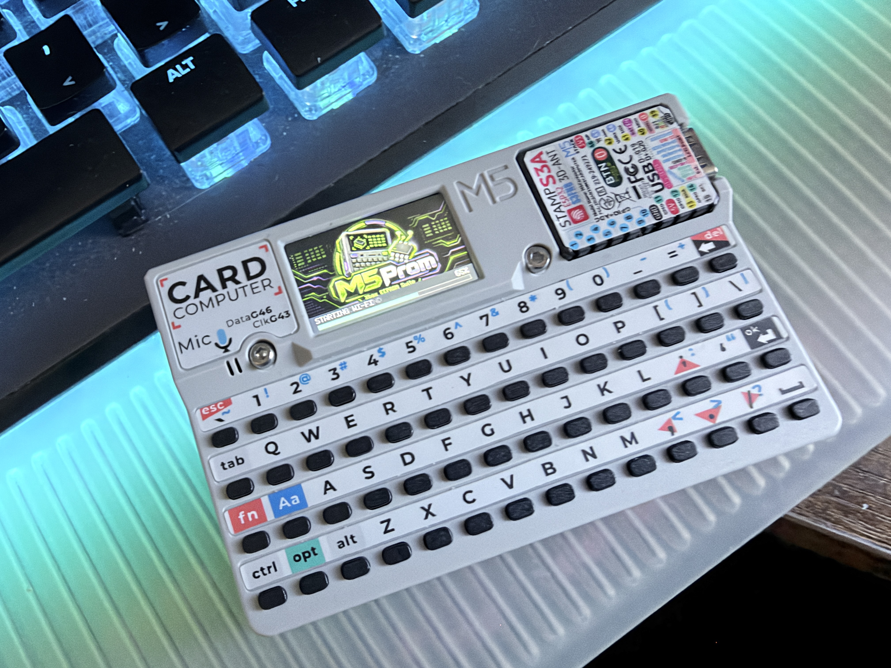

<div align="center">
  
  
</div>

<div align="center">
  
</div>

# M5 Prom

**A portable, standalone original Xbox EEPROM reader, editor and programmer for the M5Stack Cardputer.**

M5 Prom is designed for console repair and recovery work. It uses a purpose-built Cardputer-to-LPC adapter to access the original Xbox's 256-byte EEPROM **while the console is powered off**, and stores backups and edited images as ordinary files on a FAT32 microSD card. No running Xbox dashboard, computer connection or network is required for EEPROM operations.


## Features

- Read the Xbox EEPROM twice, compare the results and save a verified original backup before editing.
- **Verify-only:** Compare any saved 256-byte `.BIN` against two matching EEPROM reads without writing the chip or changing the RAM working image.
- Inspect console identity, security/checksum status and supported configuration fields.
- Edit and repair an **in-memory working copy** without changing the physical EEPROM until Write is explicitly selected.
- Create a new retail donor EEPROM from scratch or clone an existing image from RAM or microSD.
- Save and load versioned **256-byte `.BIN`** files without overwriting previous backups.
- Use the **onboard SD file manager** to browse EEPROM and TXT files, rename or copy files, delete selected items with confirmation, and read recovery reports without a computer.
- Program a connected EEPROM with prewrite backup, explicit confirmation, progress reporting and full readback verification.
- View SD filesystem and EEPROM-detection diagnostics, battery information and adapter pinout.
- Configure brightness, automatic dimming, sounds and Wi-Fi; optionally manage SD files through a local web browser.
- Press **H** on Home or Inspect to view a validated Xbox HDD key. Enter the **drive model** and **drive serial** to calculate a drive-specific ATA user unlock password; save the recovery information to a versioned `HDDKEY_####.TXT` beside the EEPROM backup.
- Optional **M5 Prom Remote** USB companion: mirror the real display, record MP4/screenshot PNG, send PC keyboard input and browse files on FAT32.

## Supported hardware

- **M5Stack Cardputer V1.1** (Stamp-S3A / ESP32-S3, 8 MB flash). The current firmware pin mapping is **not for Cardputer ADV**.
- **Original Xbox** LPC connection using the M5 Prom adapter PCB, a correctly oriented cable and a compatible EEPROM.
- FAT32 microSD card for backup, restore and donor files.
- USB data cable for firmware flashing and optional **M5 Prom Remote**. The running native-USB Remote firmware uses a dedicated USB interface, not a conventional UART/COM port.

**Important:** M5 Prom is an **offline-only programmer**. Power the Xbox **off before connecting or operating the adapter**, and do not use it with a powered-on console. For an offline programming session, use the Cardputer's **5V IN/OUT switch in the OUT position** to power the adapter as designed. Do not confuse that switch with the Cardputer's main power control. Follow the PCB markings and the schematic in [`img/`](img/) for connector orientation; never connect an unregulated 5V line directly to the EEPROM's 3.3V supply.

### Adapter connection reference

The adapter's **four-pin Cardputer/Grove connector (CN1)** carries `SCL`, `SDA`, `5V` and `GND` (pins **1–4**, respectively). On the original Xbox LPC side, the design routes **SCL to LPC 13**, **SDA to LPC 14**, **ground to LPC 2/12**, and **regulated 3.3V to LPC 9/15**. Refer to the actual PCB silkscreen and schematic in [`img/`](img/) before connecting a cable; **connector orientation matters**.

Manufacturing files (Gerbers, BOM and pick-and-place) belong in [`pcb/`](pcb/). These are manufacturing files, not substitutes for checking the assembled board and cable before use.

## Getting started

1. Insert a FAT32 microSD card into the Cardputer. Existing files can remain on the card; M5 Prom **does not format it**.
2. With the Xbox powered **off**, connect the adapter to the Xbox LPC header and the Cardputer Grove connector, checking orientation before applying adapter power.
3. Set the Cardputer 5V direction switch to **OUT**, then start M5 Prom.
4. From the home screen press **`0`** for Settings, select **Diagnostics** and press **Enter**. Confirm that the SD test shows **RW VERIFIED** and that the EEPROM is detected at address **`0x54`**.
5. Return to the home screen. Select **Read** and press **Enter**. M5 Prom performs two EEPROM reads, checks that they match and saves an **`ORIGINAL_####.BIN`** backup to microSD.
6. Inspect, edit or save the working image as needed. Use **Write** only when you are ready to program the physical chip.
7. For HDD recovery, press **`H`**, enter the **drive model** (`M`) and **drive serial** (`S`), preview the derived unlock password (`P`), then press **Enter** to save a recovery TXT file to SD. This does **not** unlock a drive by itself.

If an SD test fails, fix it before attempting to write an EEPROM. A verified prewrite SD backup is mandatory for physical programming.

## Home screen

M5 Prom uses a **3 × 3 menu**. Press **`1`–`9`** to highlight a command, then **Enter** to open or run it; you can also navigate with the directional keys.

| Key | Command | What it does |
|:---:|---|---|
| `1` | **Read** | Read the physical EEPROM twice, verify matching data and save an original backup. |
| `2` | **Save** | Save the current working EEPROM image as a new `.BIN` file on microSD. |
| `3` | **Load** | Browse stored EEPROM images on microSD and load one into RAM. |
| `4` | **Inspect** | View serial/MAC and EEPROM validation details. |
| `5` | **Edit** | Change supported identity, region and configuration fields in RAM. |
| `6` | **Repair** | Inspect and apply supported field/checksum fixes to the working copy. |
| `7` | **Write** | Prepare a verified backup, confirm and program the attached EEPROM. |
| `8` | **Revert** | Discard edits and restore the current image's original in-memory contents. |
| `9` | **Donor** | Create a new EEPROM image or clone an existing one. |

### Keyboard reference

| Keys | Action |
|---|---|
| `W` / `S` | Move up / down in menus and lists. |
| `A` / `D` | Move left / right on the home grid; adjust selectable values. |
| Arrow keys | Directional navigation where supported by the keyboard. |
| `Enter` | Select, open, confirm or apply. |
| `Backspace` | Go back; when typing, delete the previous character. |
| `Esc` | Cancel an active text-entry screen. |
| `0` (home) | Open **Settings**. |
| `F` (home) | Open the onboard **SD File Manager**. |
| `B` (home) | Show **Battery** information. |
| `P` (home) | Show adapter **Pinout**. |
| `M` (home) | Toggle UI sound effects. |
| `H` (home or Inspect) | Open HDD Recovery (HDD key and optional ATA unlock-password calculation). |
| `V` (home or Inspect) | Browse saved EEPROM files for read-only verification against the physical chip. |
| `V` (Load file list) | Verify the highlighted `.BIN` without loading it into the working image. |
| `Tab` (Editor) | Change editor field group. Keys `1`–`6` select a group directly. |
| `Tab` (Wi-Fi password) | Show or hide the typed password. |
| `Y`, release, then `Enter` (Write confirmation) | Arm a physical write, then explicitly begin programming. **W** remains navigation and cannot arm. |

In **Edit**, use `W`/`S` to select a field and `A`/`D` or `Enter` to change it; text fields open a dedicated editor. Edits remain in RAM until you use **Save** or **Write**. Backing out of a screen is **not** a physical EEPROM write.

### Creating a donor EEPROM

Open **Donor** (`9`) and choose one of the following:

- **From Scratch:** Choose the Xbox EEPROM revision family. M5 Prom generates a new donor without needing a source image and automatically saves it to microSD as `DONOR_####.BIN`. If saving fails, the generated image remains **unsaved in RAM** until you save it manually.
- **Copy Loaded Image:** Clone the current RAM image. Edit as needed, then select **Save** to create a new file.
- **Copy Image From SD:** Browse an existing `.BIN` image, load a copy into RAM, edit it and select **Save**. The source file is not overwritten.

A scratch donor generates a **new HDD key**. It will **not unlock a drive locked using the original EEPROM key**; retain your original backup before replacing an EEPROM.

### HDD key and drive unlock recovery

Open **HDD Recovery** by pressing **`H`** from Home or Inspect after loading or reading a valid EEPROM. The Xbox HDD key is available only if the EEPROM's encrypted security block authenticates successfully.

| Key in HDD Recovery | Action |
|---|---|
| `M` | Type the **hard drive's ATA IDENTIFY model** (maximum 40 ASCII characters). |
| `S` | Type the **hard drive's ATA IDENTIFY serial** (maximum 20 ASCII characters). |
| `P` | Preview the calculated **32-byte ATA USER password** (only when both fields are valid). |
| `Enter` | Save the currently available recovery information to a **new** SD text file. |
| `Backspace` / cancel | Return without saving; the EEPROM working copy is unchanged. |

In either text editor, type normally; **Backspace** erases a character, **Enter** accepts the field and **Fn+`** cancels. The Remote desktop application forwards the same keystrokes when connected. **Both drive fields are required** for ATA password calculation; with neither entered, Enter still exports the Xbox HDD key by itself. An incomplete pair will not generate or save a misleading ATA password. The entered model and serial are **session-only**; opening HDD Recovery again clears them.

The algorithm is **HMAC-SHA1(key = decrypted Xbox HDD key, data = model bytes followed by serial bytes)**. The ATA USER password is its 20-byte digest followed by **12 zero bytes**; the text report includes the full 32-byte password as 64 hexadecimal characters. Only trailing ASCII spaces from the ATA IDENTIFY fields are trimmed: case, internal spaces and leading spaces are significant. **Use actual drive IDENTIFY values**, not the console serial or a shortened marketing name from a label. This simple editor accepts printable ASCII; unusual non-ASCII drive identifiers are not supported for manual entry.

Reports are stored at `/EEPROMs/<console-serial>/HDDKEY_####.TXT` on the mounted FAT32 filesystem, exclusively numbered and verified after saving. This operation **does not write to the Xbox EEPROM or perform any ATA command**; unlocking an attached drive requires a separate compatible utility or adapter. Keep the resulting TXT private because it contains recoverable HDD security secrets. A newly generated donor HDD key will not unlock an existing drive locked with the console's former key.

### Verify-only: compare SD image with physical EEPROM

Verification does **not** require loading or replacing your current working image.

1. With the Xbox connected through the LPC adapter and the FAT32 card available, press **`V`** from Home or Inspect.
2. Select an EEPROM folder under `/EEPROMs/`, then select the reference `.BIN` file.
3. M5 Prom reads exactly 256 bytes from the selected FAT file, obtains **two matching physical reads** from EEPROM address `0x54`, and compares all 256 bytes.
4. It shows **256/256 bytes match** on success, or the number of differing bytes and the first mismatching offset plus SD/chip byte values on failure.

You can also highlight a file in **Load** and press **`V`** to verify that file without loading it; **Enter** in the normal Load browser continues to load as before. Backspace cancels browsing. No write command, new SD backup, EEPROM change or modification to the in-memory working image is performed. A matching image may still contain invalid security/checksum fields: Verify tests **byte equality**, not whether a retail image is semantically valid. Use Inspect/Repair for those checks.

### Writing an EEPROM

1. Load, create or edit the intended image, then verify its details.
2. Select **Write** (`7`, then Enter). M5 Prom reads the target, compares two physical reads, and saves verified **`PREWRITE_####.BIN`** and **`TO_WRITE_####.BIN`** files to SD.
3. Review the target/source details and any security or revision warning.
4. Press **`Y`** to arm; release it, then press **Enter** to begin programming. **W is not a write shortcut**, because it is reserved for navigation. **Backspace** cancels while still on the confirmation page.
5. Watch the progress indicator. Programming progress tracks EEPROM write acknowledgements, then completes **two full verification reads**. **100% means the entire EEPROM was verified.**

**Never disconnect or power down during a write.** Once physical programming begins there is **no mid-write cancellation**. If interrupted or reported unsuccessful, the EEPROM may be partially programmed; retain the prewrite backup for recovery.

## Onboard SD file manager

Press **`F`** on the Cardputer home screen to open **SD File Manager**. It uses the existing FAT32 card and is limited to the `/EEPROMs/` area, where M5 Prom keeps console folders, EEPROM backups and HDD recovery reports. **Load** and **Verify** remain separate commands on the home screen.

| Where | Key | Action |
|---|---|---|
| Folder list | `W` / `S`, `Enter` | Choose a folder and open its files. |
| Folder list | `N` | Create a folder. |
| Folder list | `R` | Rename the selected folder. |
| Folder list | `X` | Delete the selected folder **only if empty**. |
| File list | `W` / `S`, `Enter` | Browse files. Enter displays EEPROM `.BIN` information or opens a `.TXT` report. |
| File list | `R` | Rename the selected file, keeping its `.BIN` or `.TXT` extension. |
| File list | `C` | Copy the selected file to a chosen console folder, including its current folder. |
| File list | `X` | Delete the selected file. |
| File list | `V` on a `.BIN` | Compare that image with the attached EEPROM using read-only Verify. |
| TXT viewer | `W` / `S` | Scroll by one displayed line. |
| TXT viewer | `A` / `D` | Scroll by one page. |
| Name editor | `Enter` / `Esc` | Save the new name or cancel. Backspace deletes characters. |
| Delete confirmation | `Y`, release, `Enter` | Arm and then delete; Backspace cancels. |

Copying uses a new file and verifies its contents after writing. **Existing files are never intentionally overwritten.** When copying into the same folder, names such as `ORIGINAL_0001_C01.BIN` are generated automatically. A folder containing backups cannot be deleted until its contents are removed individually; there is no recursive deletion.

The handheld browser shows supported `.BIN` and `.TXT` files only, with a current limit of 40 entries per folder/list; larger collections can be managed through the desktop Remote or Web Files. Filenames must use letters, numbers, hyphens, underscores or periods (maximum 31 characters), with no path separators. TXT viewing is read-only and wraps lines to the screen width; very long text files show their first 64 KiB. The file manager does not program the Xbox EEPROM, modify the loaded RAM image or reformat the SD card. It shares the same SD access lock as the web and USB file managers.

## M5 Prom Remote — USB desktop companion

The optional [**`remote/`**](remote/) companion provides a large live view of the **actual Cardputer 240×135 screen**, keyboard control from the PC, screenshot/MP4 recording and a graphical FAT32 file manager. It works over the Cardputer's built-in **native USB-OTG vendor interface on USB-C**, without Wi-Fi or a separate UART adapter.

For Windows, double-click **`remote/M5Prom-Remote.bat`**. The launcher creates a private Python environment and automatically installs any missing, latest-compatible **PySide6-Essentials, pyusb, libusb-package, numpy, imageio and imageio-ffmpeg** packages—no pinned package versions. Python 3.10+ and internet access for first-run setup are required.

Choose **M5 Prom Native USB** and click **Connect**. Its physical LCD switches to **PC MODE ACTIVE**, while the normal application menus remain fully accessible in the remote window. Click the PC display to give it keyboard focus; Enter, arrows, Esc/Backspace, Tab and ordinary M5 Prom shortcuts all work. After disconnect or lost USB heartbeat, the Cardputer resumes local use automatically.

**Native USB mirroring:** The companion transmits only changed framebuffer regions and uses compression where beneficial. The application uses USB-OTG rather than a normal runtime serial COM port; use matching native-USB firmware and desktop app.

**File manager:** View, upload, download, rename and delete files, or create new folders in the existing FAT32 filesystem. Transfers are serialized behind the same protection used by EEPROM reads/writes and the web manager. The PC cannot mount the SD card as raw USB Mass Storage. The device continues to enforce all existing EEPROM write confirmation and backup requirements.

**Privacy:** Recordings and HDD recovery TXT files can contain console identity and key material. Treat them as sensitive before sharing or uploading.

**Windows USB note:** The native device uses WinUSB; if it does not enumerate, check the driver binding and the guidance in [`remote/README.md`](remote/README.md). Keep the ROM BOOT flashing path available. Prototype USB VID/PID values should not be treated as production identifiers.

See [`remote/README.md`](remote/README.md) for a user walkthrough and [`remote/PROTOCOL.md`](remote/PROTOCOL.md) for the optional technical details. Installing this patched firmware does not require installing the PC software; M5 Prom still runs standalone.

**Performance diagnostics:** The desktop companion can show screen FPS, USB transfer rates, key acknowledgements and queue/heap information. Use **Export Diagnostics CSV** when troubleshooting responsiveness. See [`remote/README.md`](remote/README.md) for the viewer and file-transfer controls.

## microSD and files

The card uses its **existing FAT32 filesystem**, mounted internally at `/sdcard`. EEPROM backups, donor images and text reports are stored as normal files (not raw SD sectors), accessible through the built-in file manager or from a PC:

```text
/EEPROMs/
└── <12-digit-serial>/
    ├── ORIGINAL_0001.BIN
    ├── DONOR_0001.BIN
    ├── PREWRITE_0001.BIN
    ├── TO_WRITE_0001.BIN
    ├── HDDKEY_0001.TXT        # Xbox HDD key; optional drive-specific ATA password
    └── ORIGINAL_0001_C01.BIN  # Example onboard file-manager copy
```

File names and sequence numbers vary by operation. M5 Prom also supports a fallback folder name when the serial number is invalid. Each EEPROM image is **exactly 256 bytes**, with a new version created instead of overwriting an existing file. Treat backups as sensitive: they contain console-specific identity and security material.

If saves fail, open **Settings → Diagnostics → Enter** for a non-destructive filesystem read/write test. You can also use **Settings → Remount SD** with **Web Files OFF**. FAT long-filename support is required when building from source; **do not format the SD card just because a save failed**.

## Settings and wireless file manager

Press **`0`** on the home screen to access:

- **Brightness:** 10–100%; **Auto Dim:** Off, 30 s, 1 min, 2 min or 5 min.
- **Sound Effects:** On/Off.
- **Battery:** View approximate voltage-based charge level and trend. Cardputer v1.1 does not provide a charging-current sensor; current (mA) cannot be read.
- **Wi-Fi Mode:** Off, Auto, Station or SoftAP. Auto attempts saved Station Wi-Fi first and falls back to SoftAP if unavailable.
- **Join Network:** Scan nearby **2.4 GHz** Wi-Fi networks and enter credentials.
- **Web Files:** On/Off (**off by default**).
- **Network Info:** View the current IP address and SoftAP details.
- **Remount SD** and **Diagnostics:** Check removable storage and EEPROM communication.

The device's SoftAP network is named **`M5Prom-XXXX`** (device-specific suffix) with default password **`myprom83`**. To use the file manager, enable **Web Files**, connect a phone or computer to the same local network, and open the IP address shown in **Network Info** in a browser. The web manager supports browsing, upload/download, directory creation, renaming and deletion on the SD card.

The browser interface is **intended only for a trusted private network**. It uses HTTP without a separate web login. Do not port-forward it or expose it to the internet, and switch **Web Files OFF** when not needed. During protected EEPROM/SD operations, conflicting web file requests are temporarily rejected rather than allowed to interrupt a backup.

## Flashing a precompiled release

Compiled releases, once published, belong in [`firmware/`](firmware/). A complete install uses **three matching binaries from the same build**:

```text
firmware/
├── bootloader.bin
├── partitions.bin                 # or partition-table.bin
└── cardputer_xbox_eeprom.bin      # application name may vary
```

For Windows, the supported user-facing method is the simple **PySide6 GUI flasher** in [`tools/`](tools/):

1. Double-click **`tools/M5Prom-Flasher.bat`**. On first launch it installs missing Python dependencies automatically.
2. Select the Cardputer's USB COM port.
3. Click **Browse** to select your **bootloader**, **partition table**, and **application firmware** `.bin` files. They can be located anywhere on your PC and do not need special filenames.
4. Click **Flash** and follow the progress indicator. Do not disconnect during programming.

The launcher requires Python 3.10+. Flashing is separate from **M5 Prom Remote**. Close Remote and enter ROM BOOT download mode (hold BOOT/G0 while resetting) before using the flasher; normal M5 Prom runtime uses native vendor USB, not a COM port.

**v0.9.4 flash offsets (ESP32-S3):**

| Image | Offset |
|---|---|
| Bootloader | `0x00000` |
| Partition table | `0x08000` |
| Factory application | `0x10000` |

These offsets correspond to the `/src/partitions.csv` layout (8 MB flash with a 3 MB factory-app partition). **Do not mix files from different firmware builds or use these offsets if you have changed the partition layout.** The script does not mass-erase the flash, so NVS settings outside the flashed image ranges are normally retained. If the computer cannot connect, check the USB data cable, port selection and Cardputer download/bootloader mode.

> **Precompiled images are not required to browse or build the source.** The `/firmware` folder may remain incomplete until binaries for a release have been published.

## Build from source

M5 Prom is an **ESP-IDF C project** targeting the ESP32-S3, not an Arduino sketch. The source project lives in [`src/`](src/), which contains the root `CMakeLists.txt`, `main/`, `sdkconfig.defaults`, and `partitions.csv`.

**Requirements:** ESP-IDF **5.5.x** (developed against **5.5.5**), Python environment supplied by ESP-IDF, CMake/Ninja, and an ESP32-S3 toolchain. In an ESP-IDF-enabled terminal:

```powershell
cd src
idf.py set-target esp32s3
idf.py menuconfig
idf.py fullclean
idf.py build
idf.py -p COM7 flash monitor
```

In `menuconfig`, ensure **Component config → FAT Filesystem support → Long filename support** is enabled (prefer **Long filename buffer in heap**). This is needed for serial-number directories and filenames such as `ORIGINAL_0001.BIN`. `sdkconfig.defaults` supplies intended settings for a fresh build, but an existing `sdkconfig` can override them.

For the native-USB Remote build, check **Component config → TinyUSB Stack** for one vendor interface, an **8192-byte TX FIFO**, a **4096-byte RX FIFO**, and an **8192-byte vendor endpoint buffer**. The USB vendor endpoint is still Full Speed; that buffer is an internal transfer buffer, not a USB packet-size setting. The active `sdkconfig` controls the build, even if `sdkconfig.defaults` contains different values.

When preparing a precompiled firmware release, copy these three outputs from `src/build/` into `/firmware`:

| Build output | Release file |
|---|---|
| `src/build/bootloader/bootloader.bin` | `firmware/bootloader.bin` |
| `src/build/partition_table/partition-table.bin` | `firmware/partitions.bin` |
| `src/build/cardputer_xbox_eeprom.bin` | `firmware/cardputer_xbox_eeprom.bin` |

Only publish these as a matched set from a successful build. If you have changed the default partition layout, update the flash tool before publishing your binaries.

## Repository structure

```text
M5-Prom/
├── README.md                 # This guide
├── img/                      # logo.png, Darkone83.png, PCB renders, schematic
├── pcb/                      # Gerbers, BOM, pick-and-place manufacturing data
├── src/                      # Complete ESP-IDF application project
│   ├── CMakeLists.txt
│   ├── main/
│   ├── partitions.csv
│   └── sdkconfig.defaults
├── firmware/                 # Optional compiled matched binary sets
├── tools/                    # Existing PySide6 firmware flasher
│   ├── M5Prom-Flasher.bat
│   ├── flash.py
│   ├── flasher_gui.py
│   └── flasher_core.py
└── remote/                   # USB desktop companion
    ├── M5Prom-Remote.bat      # Double-click Windows launcher
    ├── bootstrap.py          # Installs missing current dependencies
    ├── remote_app.py         # PySide6 display / recorder / SD UI
    ├── worker.py             # Native USB and file-transfer worker
    ├── video_recorder.py     # Nonblocking background MP4 encoding
    ├── protocol.py           # Framing, CRC and protocol constants
    ├── README.md
    └── PROTOCOL.md
```

## Troubleshooting

| Symptom | What to check |
|---|---|
| SD card not detected or save fails | FAT32 card, insertion, **Settings → Diagnostics**; check FatFs long filenames in an existing build. Do not reformat a card containing backups. |
| EEPROM not detected | Console powered off, adapter orientation/connections and **Diagnostics** (`0x54`). |
| Read fails | Stable adapter connection; the two physical reads must match. A failed read does not create a new original image. |
| Write refuses to start | A valid working image and a writable microSD are required, along with successful **PREWRITE** and **TO_WRITE** backups. |
| HDD ATA password unavailable | Load an EEPROM with a valid authenticated security block; enter **both** the drive model (`M`) and drive serial (`S`) exactly as ATA IDENTIFY reports them. A console serial is not the HDD serial. |
| Wi-Fi browser unavailable | Check Wi-Fi mode and IP under **Network Info**, enable **Web Files**, and use a private local connection. |
| Flasher reports missing files | Select the three matching ESP-IDF `.bin` files with the GUI Browse buttons. |
| USB flash connection fails | Enter the Cardputer ROM BOOT download mode, choose its COM port in the flasher, and use a data-capable cable. The app-running native USB interface is not a flasher COM port. |
| Remote app will not connect | Flash the matching native-USB firmware, reconnect the cable, check WinUSB device enumeration and click Refresh Devices; the normal COM port does not appear in PC Mode. |

## Credits and licensing

M5 Prom is a **Darkone83** project. The implementation draws on original Xbox EEPROM formats and community research, including the [XboxEepromEditor](https://github.com/Ernegien/XboxEepromEditor) project and Darkone83's XbDiag work.

The source includes EEPROM timezone data derived from **XboxEepromEditor (GPL v2)**; see [`src/third_party_licenses/XboxEepromEditor_GPL-2.0.txt`](src/third_party_licenses/XboxEepromEditor_GPL-2.0.txt) and preserve applicable notices and source-distribution obligations. A separate top-level project license should be specified before the repository is formally released.

M5 Prom is an independent repair tool and is not affiliated with Microsoft or M5Stack.
